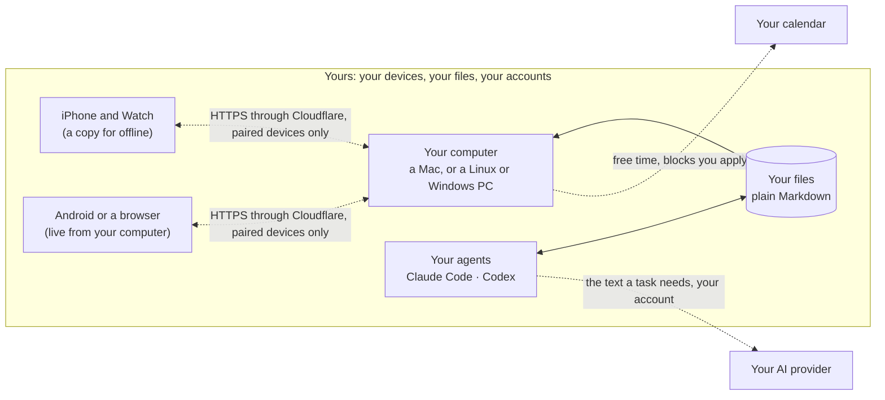

# Gubernos

**Gubernos** is a personal operating system: one working model of your life, steered day by day. What you are
responsible for, what you have promised, what you want and what you still have to decide, wired to your projects, your
tasks and today. It keeps that model in plain Markdown files you own and gives you, and your AI agents (Claude Code,
Codex), one place to steer it. The name is Latin *gubernare*, to steer. The method is inspired by David
Allen's Getting Things Done®, Gabriele Oettingen's WOOP and Brian Johnson's Heroic (Masterpiece Days, protocols);
Gubernos is not affiliated with any of them.

> **Beta.** Gubernos is in beta: the iPhone and Apple Watch app is on TestFlight, the Mac app is a download from this
> repository's Releases. Things change quickly, and your files stay yours whatever happens (plain Markdown on your own computer).

### Install Gubernos

**Before you install: you need an AI subscription.** Claude with Claude Code (Pro or higher), or any ChatGPT subscription. Gubernos runs on it: the first interview, the chat and the agents all need it. Don't have one? Get it first: [Claude plans](https://claude.com/pricing) · [ChatGPT plans](https://chatgpt.com/pricing).

**On your Mac** (macOS 13 or later), no Terminal needed:

1. Download **[Gubernos.dmg](https://github.com/old-bozman/gubernos/releases/latest/download/Gubernos.dmg)**, open it and double-click **Gubernos**. macOS asks whether to open an app
   downloaded from the Internet: **Open**.
2. A page opens in your browser: your name, where your files live, and your AI model (it gets it for you, you sign in).
   A few minutes, and Gubernos runs on your Mac.
3. Gubernos interviews you, by voice if you like: about 10 minutes, and it ends with your plan for today.

**On your iPhone:**

1. Install **TestFlight** from the App Store.
2. On the iPhone, open **[testflight.apple.com/join/rBUGmgJG](https://testflight.apple.com/join/rBUGmgJG)** → **Accept** →
   **Install**.
3. On the Mac, Gubernos → **Connect your iPhone** → **Set up**, then point the iPhone's Camera at the code. The phone
   keeps a copy of your files from the Mac, so it works when the Mac is away too.

**On Android:** open Gubernos in Chrome and install it as an app ([how](docs/install.md#android)).

**On Windows:** in PowerShell, `irm https://gubernos.app/install.ps1 | iex` (it gets WSL and Ubuntu when they're missing). **On Linux:** `curl -fsSL https://raw.githubusercontent.com/old-bozman/gubernos/main/install.sh | bash -s -- --wizard`. Then the same setup page in your browser ([more](docs/install.md#linux-or-windows-in-wsl)).

**Or let your AI agent do the setup**, on a Mac, Linux or Windows. Open Claude Code or Codex (the table in [SETUP.md](SETUP.md) shows
how to get one) and paste:

```
Install Gubernos for me: read https://raw.githubusercontent.com/old-bozman/gubernos/main/SETUP.md and do the part "For the agent".
```

By hand in the Terminal: `curl -fsSL https://raw.githubusercontent.com/old-bozman/gubernos/main/install.sh | bash`
(details: [docs/install.md](docs/install.md)).

Feedback: in TestFlight take a screenshot → **Share Beta Feedback**, or open an issue here.

<picture>
  <source media="(prefers-color-scheme: dark)" srcset="docs/img/concept-wheel-dark.svg">
  
</picture>

**The model.** Each ring is a slower horizon, and anything on an inner ring links outward to why it matters: today's #1
→ a project → a goal → an area of your life.

<picture>
  <source media="(prefers-color-scheme: dark)" srcset="docs/img/concept-loops-dark.svg">
  
</picture>

**Life loops.** A day inside a week inside a quarter. Every loop plans, does and looks back, and each review carries
what you learned back into the model. Everything you capture (voice, the watch, shared links, mail) lands in the Inbox
and feeds them; an agent proposes what each item is, you decide.

**Where your data lives.** Everything stays with you; there is no Gubernos server to send it to.



**The app and your agent.** Your agent can do anything you can describe. Gubernos adds the structure an agent does not
keep on its own: the model, the loops and a screen for each step (the morning plan against your calendar, habits on the
watch, inbox triage, weekly wins and review, handing tasks to agents and accepting their work). Both work on the same
files. The whole explainer is in the app (More → How it works) and at [gubernos.app](https://gubernos.app); its source
is `public/concept.js` (`node scripts/build-concept.mjs` refreshes the site and these pictures).

## This repository

The app over the vault of Markdown files: the files are the only store, no database. Obsidian and agents keep working on
the same files.

Runs on a Mac, Linux, or Windows (in WSL); the iPhone app, or Android and any browser as an installed web app, reaches it over HTTPS through a Cloudflare Tunnel to the computer (`cloudflared`; nothing to install on the phone), or Tailscale if you prefer.
**New here? [SETUP.md](SETUP.md)** (the short version, phone first: [docs/install.md](docs/install.md)) — clone, open your AI agent (Claude Code or Codex), say "run SETUP.md": it installs the app, creates the vault from
`kit/vault/` and onboards you. Working on the code? Read [AGENTS.md](AGENTS.md).

Who and where come from two files, both written by `scripts/setup.sh`: `~/.config/gubernos/config.json` (vault path, port,
phone URL, Obsidian vault) and the vault's `profile.md` (name, language, categories, working hours, assistant) — see `lib/config.js`.

## Features

- **Lists**: Inbox (captures from `01_inbox/` + tasks without a project), Today, Upcoming, Agents, Waiting, Someday,
  Completed (with Reopen), projects (create / edit / complete; Outcome shown under the title; "+ New goal…" in the goal picker). Subtasks = checkboxes in the task body, expandable
  inline. Global search over open tasks + projects, with "search by meaning" (the app's model) when nothing matches literally.
- **Notes (capture now, clarify later)**: "Save as note" in the add dialog (typed or dictated), or voice "заметка / идея / note …"
  (a longer musing is recognised too) → a raw note in `01_inbox/` (`type: item, source: manual`), shown on Inbox under
  **Notes** with the text. Each note → **Task**, **Project**, **Goal**, **✦ Agent**, **Ask** (discuss it with the agent; a task it
  proposes clears the note), Archive, Delete (kept in the archive as trash). Processed notes move to `80_archive/` with "Processed → task/project [[…]]".
- **Group by** (layers icon in the list header): Default · Project · Category · Priority · Owner, per view, remembered in the browser.
  Project groups are ordered by category and link to the project.
- **Plan the day** (menu → Focus, or the calendar icon on Today with free hours; the 08:30 digest "Plan your day · 6h free" opens it): free time today from the calendar — the Mac's own (Calendar.app, EventKit: `lib/maccal.js` + `tools/calendar/`) or Google's (`lib/gcal.js`), Settings → Your Mac → Calendar, `lib/calendar.js` (9–19, minus meetings and
  a lunch hour; "Focus time" counts as working time), an agent's estimate per task and what truly has to happen today
  (cached for the day). The screen picks must-do tasks first, fills ~85% of the free time, proposes a date for the rest
  (Tomorrow / Weekend / Next week / Someday), lists agent tasks to run, and decisions due within 3 days (accept the
  recommendation or "not now" right there). **Apply** = time blocks in the calendar + agent
  runs + new dates, with Undo. Today then shows tasks beyond the free time under "Probably not today"; at 19:00 a push
  offers to move what's left (`#/plan/evening`, `GUBERNOS_EVENING_AT`).
- **What matters** (the vault's personal model, `05_model/`; each screen appears only when there is data for it):
  - **Wins** (menu, and the trophy icon on Today with done/total): up to 3 ordered results for this week — check, reorder, link to a project,
    decision or goal; asks for them when the week has none; last week and the quarter shown read-only. Stored in
    `05_model/focus.md` → `## Week (…)`; a new week moves the old one to `## Previous week (…)`.
  - **Decisions**: the queue the assistant prepares — question, options, recommendation, missing info, what happens if nobody decides,
    due date (overdue first; parked apart). ✓ accept the recommendation · choose another · not now until a date · Discuss
    (Ask with the decision as context; it can offer the same buttons). **Not a decision** closes it without a choice, or it's
    really a **task / project / goal** → that dialog opens prefilled and the decision closes with a link (`status: dropped`,
    archived). Recording follows the vault's Decision queue step 4 (5 s Undo), then
    "+ Next action" creates the follow-up task (`source: decision`). The morning digest names decisions due within 3 days.
  - **Coming up** (Plan the day, and on top of Upcoming): commitments whose time to prepare has come (`attention_at`, or a
    deadline within 30 days), wants to revisit, open issues — the same rules as the assistant's morning brief (vault `AGENTS.md` → "Attention pass"). + Task (files it under
    the commitment; an open task = handled) · Not yet (7 days) · Done this cycle (recurring: dates one period on; one-off:
    done, archived). Outcomes are logged under the file's `## Log`.
  - **Goals**: done-when, horizon, area, the projects serving each goal with open counts; link / unlink; new goal; ✎ edit
    (title, area, by when, done when) or mark achieved (→ `80_archive/goals/`).
- **Menu**: Tasks (Inbox … Completed) · Focus (Wins, Decisions) · Goals, each with the projects that serve it · other
  projects by category · Settings.
  - Tasks may be filed under a commitment / want / decision / issue; they show its title and area category.
- **Quick add**: buttons under the title — ◷ Date (Today / Tomorrow / Weekend / Next week / calendar), # Project,
  (with "+ New project" inline), ⚑ Priority, ✦ Agent — or type it all in one line: `draft SSI report fri p1 #personal-os @agent {oct 1}`. A time sets a reminder that day: `call the doctor tomorrow 10:00`, `at 10`, `3:30pm`, `в 7 вечера`. Dates in English
  and Russian: today · tonight · tomorrow/tmr · послезавтра · fri / on friday / в пятницу / пт · weekend / на выходных ·
  next week / на следующей неделе · in 3 days / через 3 дня / +3d · end of week / month · next month · 24 sep / Oct 5th /
  25 сентября / 24/9 / 2026-10-01. `p1`–`p4`, `#project`, `@agent` / `@someone` / `@label`, `{deadline}`.
  The last change wins: typing a date after picking one replaces it.
- **Task card**: Project, Due, Priority, Owner always; Deadline / Remind / Status / Labels / Repeat / time blocks only
  when set, the rest behind "+ …" links. Project → "+ New project…" creates one and moves the task (also in Process).
  Agent box = status + main buttons (Run · Accept · Accept & close); "Send back…" opens the feedback field.
- **Repeats in words**: in quick add ("pay rent every month on the 1st", "каждый понедельник", "раз в две недели"), in the
  task's Repeat field, or by voice. Stored as cron when cron can say it, else `every N days|weeks|months|years`
  (`public/recur.js`, shared by browser and server); shown back in words ("Every Monday"). Completing rolls `due` forward.
- **Swipes** (phone): right → complete (with Undo); left → Move to: Tomorrow · Weekend · Next week · pick a date (with Undo).
- **Import tasks** (Settings → General; `lib/import.js`): from Apple Reminders or Things 3 on the Mac, Todoist (its API token, used once, not kept) or any app's export / a pasted list (read by the model). Each list is shown with where it goes (a new project with its area, the project of the same name, no project, or left out); done tasks, tasks already there and past due dates stay out; nothing is written before Import. The end of the first interview points to it.
- **Completing**: 5 s grace (Settings) with Undo in the row; nothing is written until it ends. **Drop** = abandon (`dropped: true`).
- **Voice** (one floating mic on every screen; hold = push-to-talk, tap = hands-free with pause detection):
  local Whisper on the Mac (MLX: `whisper-small` for short commands, `large-v3-turbo` for dictation), then
  - known short commands run instantly (skip, done, undo, today / tomorrow / weekend / next week, drop, search X, …),
  - everything else goes to the app's model (its fast tier), which returns either task drafts (you confirm) or a command.
  Dates are never computed by the model: it returns a date spec, `lib/dates.js` resolves it on the local clock.
- **One-at-a-time modes** (full screen): **Focus** (the most important task + a 25/5 sprint timer, Why this one?,
  Break down; every finished sprint is logged to the vault's `50_reviews/pomodoros.csv`, "⚡ N today" in Focus and on Today), **Process inbox**, **Review agents** (Accept = back to you, Accept & close, Send back).
- **The model** (Settings → Your Mac → Model; `scripts/setup.sh model …`): the app's model calls go through one CLI on the
  Mac, on the owner's own subscription — Claude Code (a Claude plan with Claude Code, Pro or higher) or Codex (any ChatGPT subscription).
  `lib/llm.js` has the three kinds of call: one-shot structured answers (Codex: strict `--output-schema`), the read-only resumable chat and agent runs, each with gubernos-tools plugged in. `GUBERNOS_CLAUDE_BIN`,
  `GUBERNOS_CODEX_BIN` point at a CLI elsewhere.
- **Which agent**: a task for agents can name one — `agent: claude | codex | <assistant>` (task card → Agent, or `@<assistant>` /
  `@claude` / `@codex` in quick add). Each model whose CLI is on the Mac runs from the app (Codex: `codex exec
  --json`, workspace-write sandbox = writes only in the vault), otherwise a Codex
  session in the vault takes them; the assistant from `profile.md` (if any) picks up its own queue. Empty = any agent.
- **Agents**: tasks with `assigned: agent` have `agent_state` queued → running → review. "▶ Run" spawns
  the model's CLI on the task in the vault and streams progress; the agent reports in `## Agent log`.
- **Composer** (Ask and task chat): a floating pill `[+] [text] [mic] [●]` — ● is the mic while empty, send once there's
  text or a file. **Attachments** via +: photos / PDFs / docs are saved to the vault's `40_reference/attachments/YYYY-MM/`
  and linked from the task (or project) under `## Attachments` (`![[photo.jpg]]` renders inline); the agent reads them
  (images, PDFs) when you ask; a file without a question is simply attached.
- **Task chat = the agent** (one conversation per task): a chat block in every task card, right above Notes. It shows the
  task's `## Chat` and the agents' `## Agent log` (reports, "Sent back", run start/end) in time order. Answers come with
  action buttons (steps, dates, note, email, time block) and **▶ Do it**: the agent hands real work (web research, writing
  into the task or a reference note) to a full agent run, which works in the vault and reports back in the same chat. The line
  above the chat box shows the agent's state: queued (Run now / Take back), working (what it's doing, Stop), done
  (Accept / Accept & close / Send back — feedback is typed in the chat box), needs you (Reply & run). ✦ in the dock opens
  this chat when a task is open.
- **Ask** (✦ above the mic, `c`, or voice "спроси агента …"): with a task open → that task's chat; otherwise a chat sheet
  (right panel on desktop) about what's on screen — the project, view or an Inbox note. Read-only session of the app's model over the vault (its fast tier; "Deep" = the stronger one), follow-ups
  keep the session. Proposed changes come back as buttons (steps, due/deadline, new task, note, time block); "Save"
  appends an answer to the task's or project's `## Notes`. While the sheet is open, the mic dictates into the chat.
- **Calendar time-blocking** (the Mac's calendars or Google's): free slots → confirm → event; stored in the task under `## Time blocks`.
- **Gmail**: agents (Ask, task chat, ▶ Run) can search and read mail and see the calendar through
  `gubernos-tools`, a small read-only MCP server (`tools/gubernos-tools.js`: Gmail, Calendar, Contacts, Drive) — "что писала Caroline про счёт?". Writing is an
  action: "✉ Reply to …" opens an editable card (To / Cc / Subject / text) → **Send** or **Save draft**. Nothing leaves
  without that tap. Replies stay in the thread; mail sent from a task is linked under its `## Mail`.
  Any Claude Code session can use the same tools: `claude --mcp-config '{"mcpServers":{"gubernos-tools":{"command":"node","args":["~/dev/gubernos/tools/gubernos-tools.js"]}}}'`.
- **Notifications** (Web Push; on iPhone from the home-screen app, iOS 16.4+): turn on in Settings.
  Sends task reminders (the **Remind** field, `reminder:`), a morning digest (time set in Settings: due today / overdue / to review) and
  agent hand-backs — a task moving to `agent_state: review` or `blocked`, from the app's runs or any other agent.
  Tapping opens the task. `lib/push.js` (VAPID + aes128gcm, no deps), `lib/notify.js` (what/when, every 20 s).
- **Weekly review** (menu → Focus, key 8): look back (wins, done), inbox to zero, overdue, waiting, agent work to review,
  projects without a next action, decisions, the next two weeks (deadlines, commitments), someday, next week's wins; notes
  (went well / didn't / change) saved as `## Review (Gubernos)` in `50_reviews/<monday>_to_<sunday>.md` (or the week's existing
  review file). Monday and Tuesday review the week that just ended. `lib/review.js`.
- **Daily reflection** (menu → Focus; a push at the time set in Settings, default 22:00, unless today's is done): three
  short answers about the day, each with its own mic — format E-S-P (Effort, Success, Progress) or Journal (went well,
  needs work, improve tomorrow). One file per day in `50_reviews/daily/YYYY-MM-DD.md`; the Weekly review shows the
  week's under Look back. `lib/reflection.js`. Settings now hold the whole schedule: morning digest, evening check-in,
  daily reflection (each off or a time).
- **Protocol** (menu → Focus, `g d`; the ◐ icon on Today — its badge is the protocol on now, done/total): My Day.
  **#1** (by default this week's WIN #1) with what it leads to (task → project → goal → the longer goal); the **AM / PM
  protocols** (vault `05_model/protocols/`) as checklists in their time windows, a push when a window starts; **habits**
  (`05_model/habits/`) checked off with a value where they have a target, the last 7 days, the streak and "don't miss
  twice", the minimum version, quit habits kept / slipped, a Week tab; the **plan** as fixed in the morning, with what
  was added later. Everything goes to the day's file `50_reviews/daily/YYYY-MM-DD.md` (`## Plan`, `## Habits`, next to the
  reflection). Plan the day uses the time between the AM and PM protocols, fills the free time to your real pace (plan vs
  actual of the last two weeks, at most 85%), proposes deep work (for #1) and deep love blocks for the calendar, and asks
  about tasks carried three days. A habit's ⋮⋮ handle drags it up / down or into another block; Edit renames it and links
  it to goals, projects or wants. The week (Settings → Week starts on: Sunday or Monday) drives habits this week, the wins
  week, the weekly review and sprints. Habits can be switched off in Settings. `lib/daily.js`, `lib/habits.js`.
- **Report a bug or idea** (menu ☰ → Report bug / idea, ⌘K, or voice "баг: …" / "идея для приложения: …"): from any screen.
  Sends the text, Bug/Idea, optional screenshots from Photos, the screen's context (view, open task, device, viewport,
  recent errors) and a snapshot of the page's HTML. Becomes a task in the project "Gubernos feedback" (waiting on the
  developer) plus a line in `data/feedback.jsonl`; files in `data/feedback/`. `lib/feedback.js`.
  On someone else's install (`feedbackRelay` in config.json, set by setup.sh on every install but the developer's own,
  `"devAgent": true`) each report also goes to the developer through the relay (`relay/worker.js`, relay.gubernos.app),
  no GitHub account needed: an issue in the developer's private repo (labels `feedback` + `bug|idea`). Screenshots and the
  screen snapshot go with the "Send screenshots" tick (on by default, they can untick it; they show their tasks), stored
  next to the issue. Every 20 min the app asks the relay: the developer's comments → the task's log; a comment on an open
  issue → `blocked` (Reply), a closed issue → `review` (Works now / Still wrong) — each with a push. Reply and Still wrong
  go back as a comment and reopen the issue.
- **Settings** (menu ☰ → Settings), each where it applies: **this device** (theme, its notifications; in the iPhone app its own
  reminders, Mac address and voice), **General** and **Your day** (the same on every device: time format, week start, the
  day's times, habits…), **Your Mac** (model, voice, agents, calendar — this Mac's or Google, Google, pairing; on a phone one
  line). Reminders don't ring twice: the Mac skips an iPhone whose app rings them itself. Shared settings live in
  `data/settings.json` on the Mac.
- **⌘K** command palette, keyboard shortcuts (`?` lists them all): `g` then a letter goes to a screen (`g t` Today, `g i` Inbox, `g u` Upcoming, `g d` Protocol, `g p` Plan the day…); on the selected task `e` completes, `t` schedules, `y` steps the priority; `z` undoes; `d` cycles the theme. PWA icon.

## Run

Install: [SETUP.md](SETUP.md) (`scripts/setup.sh check | install | phone | voice | obsidian | restart | status`; update with `scripts/update.sh`).
By hand:

```
npm install                                                  # only dependency: yaml
python3 -m venv .venv && .venv/bin/pip install mlx-whisper   # speech-to-text (Apple Silicon)
GUBERNOS_VAULT=~/path/to/vault npm start                          # → http://127.0.0.1:4747 (or a vault in ~/.config/gubernos/config.json)
```

Needs one model CLI signed in — `claude` or `codex` (agent runs, chat, voice interpretation, Why / Break down / semantic search).
Whisper models download to `~/.cache/huggingface` on first use.

### As deployed on the Mac

- `deploy/gubernos.plist.template` → `~/Library/LaunchAgents/com.<user>.gubernos.plist` (setup.sh renders it): the server,
  started at login, restarted on crash. After server changes: `scripts/setup.sh restart` (UI-only changes: reload the page).
- `deploy/gubernos-awake.plist.template` (`--awake`, or later `scripts/setup.sh awake on|off|status`): `caffeinate -s` — no system sleep on AC power (closing the lid still sleeps).
- Phone: `scripts/setup.sh phone` = a Cloudflare Tunnel made by the relay (`https://m-….gubernos.dev` → the proxy port; `cloudflared` as launchd `com.<user>.gubernos-tunnel`; only paired devices get in, lib/pair.js) + the URL saved as `publicUrl`; `--tailscale` = `tailscale funnel`; `--private` = `tailscale serve` (tailnet only, Tailscale on the phone too). The mic needs HTTPS. On the Mac, `#/phone` walks through getting the app and pairing.
  iPhone: open it in Safari → Share → Add to Home Screen.
- Desktop: open the same URL in Safari → File → Add to Dock — a separate app window with its own Dock icon, so it looks native (macOS 14+).
- Logs: `server.log`; voice events from the phone are the `[voice]` lines.

### Env

| Var | Default | |
|---|---|---|
| `GUBERNOS_VAULT` | `vault` in config.json | vault root — point it at a copy for tests |
| `GUBERNOS_CONFIG_DIR` | `~/.config/gubernos` (or `GUBERNOS_GOOGLE_DIR`) | where config.json lives |
| `PORT` / `HOST` | config.json `port` or 4747 / 127.0.0.1 | |
| `GUBERNOS_PUBLIC_URL` | config.json `publicUrl` | links in calendar events, the push contact |
| `GUBERNOS_CLAUDE_BIN` / `GUBERNOS_CLAUDE_ARGS` | `claude` / edit + read-only research tools + gubernos-tools | agent runs (headless, no shell by default). `GUBERNOS_CLAUDE_ARGS` replaces all of it, gubernos-tools included |
| `GUBERNOS_CLAUDE_TOOLS` / config.json `agentTools` | none | tools added to agent runs, e.g. `Bash` (to open .xlsx with python) — the default list and gubernos-tools stay |
| `GUBERNOS_DIGEST_AT` | `08:30` | default digest time until changed in Settings (sent within 3 h after); `GUBERNOS_NO_NOTIFY=1` disables the notifier |
| `GUBERNOS_DATA_DIR` | `./data` | push subscriptions, notifier state (VAPID keys: `~/.config/gubernos/vapid.json`) |
| `GUBERNOS_STT_PYTHON` | `.venv/bin/python` | |
| `GUBERNOS_GCAL_ID`, `GUBERNOS_WORK_START`, `GUBERNOS_WORK_END`, `GUBERNOS_WORK_WEEKENDS` | primary, profile.md `workday`, off | time-blocking (the calendar written to; more calendars are read from Settings → Your Mac → Calendar) |
| `GUBERNOS_GOOGLE_DIR`, `GUBERNOS_GCAL_API`, `GUBERNOS_GMAIL_API`, `GUBERNOS_PEOPLE_API`, `GUBERNOS_DRIVE_API`, `GUBERNOS_GOOGLE_TOKEN_URL` | `~/.config/gubernos`, Google | OAuth files / endpoints (tests use a stub) |

### Google Calendar + Gmail (one-time)

Step by step: [docs/google.md](docs/google.md) — best as an **Internal** app in a Google Workspace (never expires; one
account), else External in Testing (reconnect every 7 days; the app pushes when it expires). In short: an OAuth client JSON (Desktop app) at `~/.config/gubernos/google_oauth_client.json`, then open http://127.0.0.1:4747/api/gcal/connect
**on the Mac**. The refresh token lands in `~/.config/gubernos/google_calendar_token.json` (mode 600; the name is historical,
it holds all scopes). Scopes: `calendar.events`, `calendar.freebusy`, `gmail.readonly`, `gmail.compose` (drafts + send), `contacts.readonly`,
`contacts.other.readonly`, `drive.readonly` (agents only read). The Gmail, People and Drive APIs must be enabled in the
Cloud project. A newly added scope needs one re-connect; until then only that integration answers "not granted". `GET /api/gcal/status` → `connected` (calendar), `gmail`.

## Vault conventions the app relies on

Schemas live in the vault's `CLAUDE.md`, the agent protocol in its `AGENTS.md`. App-specific:

- Frontmatter is edited through the `yaml` Document API so untouched keys keep their formatting; legacy `todoist_id`
  values are kept (always quoted).
- Completing sets `status: done` + `completed`, then archives to `80_archive/` at once. Drop = `status: done` + `dropped: true`, archived too.
- Log lines written for the owner use their id from `profile.md` (first name, lowercase): `- … · alex · …`.
- Recurring tasks (`recurrence`: cron or `every N weeks`) roll `due` forward instead of completing (`public/recur.js`).
- Body sections the app writes: `## Subtasks`, `## Agent log` (`- YYYY-MM-DD HH:MM · author · text`), `## Notes`,
  `## Time blocks` (`- ⏱ 2026-09-25 10:00–10:50 · label <!-- gcal:ID -->`),
  `## Mail` (`- ✉ [Subject](gmail thread link) · sent to X · 2026-09-26 <!-- gmail:THREAD -->`).

## HTTP API

```
GET   /api/state                          tasks, projects, goals, inbox captures, agent runs; areas, containers,
                                          goalDetails, decisions, focus (the personal model)
GET   /api/logbook                        completed / dropped (last 300)
POST  /api/tasks                          {title, notes, priority, assigned, project, due, deadline, labels[], subtasks[], todoist_id?}
PATCH /api/tasks/:id                      {title|status|priority|assigned|project|due|deadline|labels|recurrence|agent_state|body,
                                           toggleCheck: n, addSubtask, addSubtasks[], addNote}
POST  /api/tasks/:id/complete | drop | reopen
POST  /api/tasks/:id/claim | submit | block | log        agent handshake ({agent, text})
POST  /api/tasks/:id/accept {text, close?} | sendback {text}   human review
POST  /api/tasks/:id/run {brief?} → run (brief = the request from the chat, logged as "▶ Do it: …"); GET /api/runs/:id/stream (SSE); POST /api/runs/:id/stop
POST  /api/tasks/:id/breakdown            Haiku: 3–7 steps
POST  /api/tasks/:id/timeblock {start, end, subtask?}; DELETE /api/tasks/:id/timeblock/:event
POST  /api/projects; PATCH /api/projects/:slug {title, category, goal, status, outcome}
POST  /api/goals {title, area?, horizon?, success?} → 30_goals/<slug>.md from the template; PATCH /api/goals/:slug {…, status: done}
POST  /api/model/:slug/snooze {days} · /api/model/:slug/cycle      coming-up outcomes
POST  /api/decisions/:slug/decide {letter, reason?} → {choice, reason, project}; POST /api/decisions/:slug/park {review_at}
PUT   /api/focus/week {items: [{text, done}]}          this week's wins (focus.md → ## Week)
POST  /api/items {text, title?} → new note in 01_inbox
POST  /api/items/:id/process {outcome: processed|trash, taskId?, project?}
POST  /api/voice (audio body, ?quick=1) → {text}; POST /api/voice/parse {text, context} → tasks | command
POST  /api/voice/warm; POST /api/focus/why; POST /api/search/semantic {q}
GET   /api/gcal/status | connect | callback; POST /api/gcal/slots {minutes}
GET   /api/pair → {required, local, publicUrl, appLink, webLink}; POST /api/pair/required {on} | /api/pair/rotate (the Mac only)
GET   /pair?t=TOKEN → sets the gubernos_token cookie for a browser on another device (lib/pair.js)
POST  /api/chat {message, context: {taskId|project|itemId|view}, session?, deep?, persist?, attachments?[]} → {reply, actions[], session}
POST  /api/attachments?name=&task=|project= (file body) → {name, path, url, image}; GET /api/attachment/<vault path>; GET /api/attachment-by-name?name=
GET   /api/gmail/search?q= | /api/gmail/thread/:id           read
POST  /api/gmail/send | draft {to, cc, subject, body, threadId?, taskId?}   only from the confirmation card
POST  /api/tasks/:id/mail {threadId, subject}                  link a thread under ## Mail
POST  /api/projects/:slug/note {text}
GET   /api/plan/free · /api/plan/estimates; POST /api/plan/draft {refresh?} → {free, tasks: [{id, minutes, must, moveTo, why}], agents}
GET   /api/pomodoros → {today, week, last7, todayByTask}; POST /api/pomodoros {start, end (epoch ms), minutes, taskId}
GET   /api/settings; PATCH /api/settings {undoSeconds, digestAt}
GET   /api/push/key; POST /api/push/subscribe {subscription, ua} | unsubscribe {endpoint} | test
POST  /api/log {msg}                      client diagnostics → server.log
GET   /api/events                         SSE "changed" when vault .md files really change
```

## License

The app's code is MIT ([LICENSE](LICENSE)). The method that ships with it, the starter system in `kit/vault/`
(structure, templates, views, agent instructions, reference notes), is CC BY 4.0 ([kit/LICENSE.md](kit/LICENSE.md)).
Bundled third-party code: [THIRD_PARTY_NOTICES.md](THIRD_PARTY_NOTICES.md); the app shows all license texts under
Settings → About → Licenses (`public/licenses.txt`).

Getting Things Done® and GTD® are trademarks of the David Allen Company; Gubernos is not affiliated with it.
